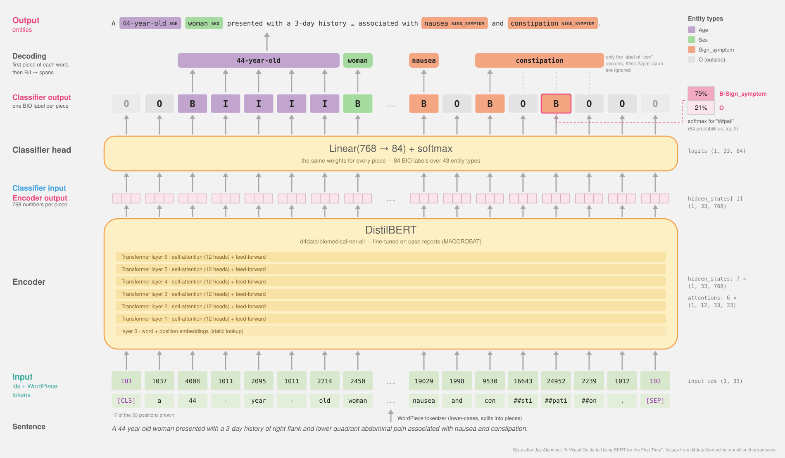

# Named Entity Recognition, step by step

## Notebooks

| Notebook | Content |
|---|---|
| [`01a-tokenization-tokens.ipynb`](01a-tokenization-tokens.ipynb) | **preliminary 01a**: the elementary operation — one routine (`tokenizer.tokenize(w)`) and seven tokenizers to plug into it |
| [`01b-tokenization.ipynb`](01b-tokenization.ipynb) | **preliminary 01b**: rule-based (spaCy/scispaCy), BPE, WordPiece, Unigram and byte tokenization compared on clinical text — algorithms re-implemented, side-by-side tables, corpus metrics, entity-boundary alignment, controlled training experiment |
| [`02a-static-embeddings.ipynb`](02a-static-embeddings.ipynb) | **preliminary 02a**: static embeddings — each token's token, position and segment vectors and their sum (layer 0), drawn as colored boxes, for five Transformer models and Word2Vec-style word vectors |
| [`ner_pipeline.ipynb`](ner_pipeline.ipynb) | **the main class**: one sentence through a Transformer NER, step by step (below) |

Preliminary notebooks are numbered (`01a-`, `01b-`, `02a-`, ...) and each zooms into
one step of `ner_pipeline.ipynb`; letters split one step into an elementary
and a detailed notebook. All notebooks are committed with their
outputs (executed with papermill, see the repository `CLAUDE.md`).

## Documentation

| Document | Covers |
|---|---|
| [`docs/notebooks_overview.md`](docs/notebooks_overview.md) | **start here** — the series, suggested order in class, how the notebooks connect |
| [`docs/ner_pipeline.md`](docs/ner_pipeline.md) | design and rationale of the main class, section by section, with committed results and a verification checklist |
| [`docs/tokenization.md`](docs/tokenization.md) | design and rationale of 01a and 01b, with committed results |
| [`docs/static_embeddings.md`](docs/static_embeddings.md) | design and rationale of 02a, with committed results |
| [`docs/data_and_models.md`](docs/data_and_models.md) | the MultiCaRe sample, MACCROBAT, every model and tokenizer, `ner_helpers.py` |
| [`docs/environment.md`](docs/environment.md) | local setup, pins, caches, Binder, executing with papermill, maintenance, troubleshooting |

## `ner_pipeline.ipynb`



An interactive class that follows one sentence from a clinical case report
through a Transformer-based NER system, exposing every intermediate step:

1. **spaCy / scispaCy pipeline** — sentence splitting and rule-based tokens
2. **Static word vectors** — one vector per word type, blind to context
3. **WordPiece tokenization** — sub-word pieces, ids, and their alignment to words
4. **Layer 0** — BERT's own embedding table (token + position), rebuilt by hand
5. **Six Transformer layers** — attention, and how a word's vector becomes contextual
6. **The classifier** — its input (768-d vectors) and output (84 logits), rebuilt by hand
7. **Decoding** — sub-word BIO labels → word labels → entity spans → spaCy `Doc` / displacy
8. **What fine-tuning changed** — `distilbert-base-uncased` vs `d4data/biomedical-ner-all`:
   distance of word vectors to entity-type centroids, layer by layer, plus
   silhouette, nearest-centroid and linear-probe measures
9. **A different architecture** — spaCy's CNN + transition-based NER

with four 🧩 challenges along the way.

## Run it

**On Binder** (nothing to install):
[launch the folder](https://mybinder.org/v2/gh/santanche/nlp2learn/binder-ner?urlpath=git-pull%3Frepo%3Dhttps%253A%252F%252Fgithub.com%252Fsantanche%252Fnlp2learn%26urlpath%3Dlab%252Ftree%252Fnlp2learn%252Ftechniques%252Fner%26branch%3Dmain)
or [launch `ner_pipeline.ipynb`](https://mybinder.org/v2/gh/santanche/nlp2learn/binder-ner?urlpath=git-pull%3Frepo%3Dhttps%253A%252F%252Fgithub.com%252Fsantanche%252Fnlp2learn%26urlpath%3Dlab%252Ftree%252Fnlp2learn%252Ftechniques%252Fner%252Fner_pipeline.ipynb%26branch%3Dmain)
— the links work once the `binder-ner` branch is published; see
[`docs/environment.md`](docs/environment.md#2-binder) and
[`binder-env/README.md`](binder-env/README.md).

**Locally**, with [uv](https://docs.astral.sh/uv/) (from this folder):

```bash
uv venv --python 3.12
source .venv/bin/activate          # .venv\Scripts\activate on Windows
uv pip install -r requirements.txt
jupyter lab ner_pipeline.ipynb
```

The first run of `ner_pipeline.ipynb` downloads the two DistilBERT models
(~0.5 GB, into the default Hugging Face cache `~/.cache/huggingface`) and
MACCROBAT (~1 MB, into `~/.cache/nlp2learn/maccrobat`). A full run takes
about 2 minutes on a laptop CPU and peaks at ~1.2 GB of RAM.

The `01a`/`01b` tokenization notebooks need nothing more: they download
only tokenizer files (a few MB per model, no weights) and reuse the
MACCROBAT cache. They run in about 10 and 30 seconds.

`02a-static-embeddings.ipynb` downloads four more checkpoints on its first
run (BERT, BiomedBERT, RoBERTa, ALBERT: ≈1.1 GB) but keeps only their
embedding layers in memory; it runs in about 20 seconds.

## Files

| Path | Content |
|---|---|
| `01a-tokenization-tokens.ipynb` | preliminary notebook 01a: tokens, a first look |
| `01b-tokenization.ipynb` | preliminary notebook 01b: tokenization approaches compared |
| `02a-static-embeddings.ipynb` | preliminary notebook 02a: static embeddings, a first look |
| `ner_pipeline.ipynb` | the class |
| `ner_helpers.py` | plumbing only: MACCROBAT download, brat parsing, span → token alignment, drawing vectors as colored boxes |
| `sample/` | 50-article sample of MultiCaRe converted to CSV (same as `to-kg/data/csv/sample`) |
| `requirements.txt` | environment, shared by the local and Binder setups |
| `binder-env/` | Binder image definition (published as branch `binder-ner`) |
| `docs/` | project documentation (see above) |
| `CLAUDE.md` | design notes and decision log for the notebook series (for resuming work) |

## Design notes

In short (details and the full decision log in
[`docs/ner_pipeline.md`](docs/ner_pipeline.md#4-decisions-and-alternatives)):

* **Why not spaCy alone?** spaCy's pipelines are very explicit, but its
  neural NER hides exactly what this class wants to show: `tok2vec` hashes
  token features instead of looking up one vector per word, and the `ner`
  component is a transition-based parser, so there is no per-token
  "vector in → label probabilities out" step. spaCy is used where it is
  transparent (tokenization, sentences, displacy) and as a contrast (step 9).
* **Model sizes.** scispaCy's `md`/`lg` models are avoided because their
  vocabularies take ~1.6 GB of RAM each; `en_core_sci_sm` (no vectors) plus
  the vector table of `en_core_web_md` fit in a Binder session.
* **Leakage, on purpose.** Step 8 measures geometry on MACCROBAT, the data
  `d4data/biomedical-ner-all` was fine-tuned on. The goal is to show how
  fine-tuning reshaped the vector space, not to estimate accuracy.
* **Version pins.** scispaCy models are only published for v0.5.4, which
  needs spaCy 3.7.x, whose `thinc` wheels need `numpy<2`.

## Data and model credits

* MultiCaRe — Nievas Offidani et al., [Zenodo 10.5281/zenodo.10079369](https://doi.org/10.5281/zenodo.10079369).
* MACCROBAT2018 — Caufield, J. H. (2019), [figshare 10.6084/m9.figshare.9764942.v2](https://doi.org/10.6084/m9.figshare.9764942.v2), CC BY 4.0.
* [`d4data/biomedical-ner-all`](https://huggingface.co/d4data/biomedical-ner-all),
  [`distilbert-base-uncased`](https://huggingface.co/distilbert-base-uncased),
  [scispaCy](https://allenai.github.io/scispacy/), [spaCy `en_core_web_md`](https://spacy.io/models/en#en_core_web_md) — see their model cards for licenses.
